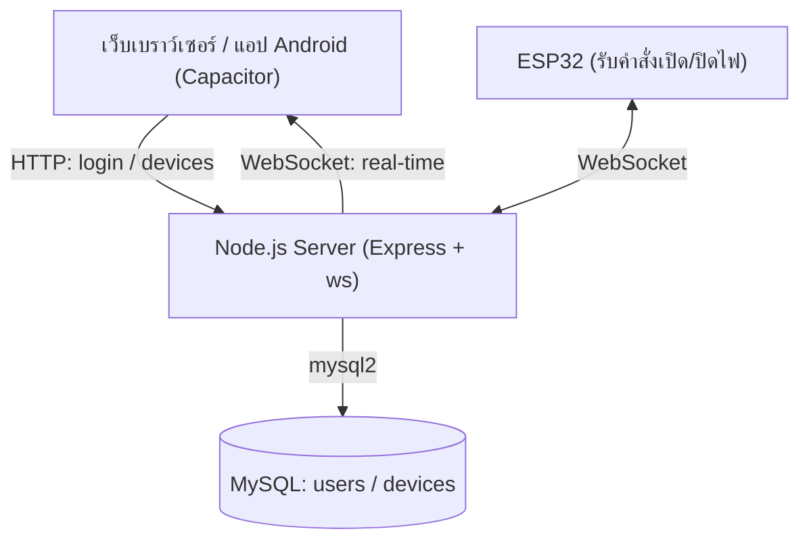

# Glowly — ระบบควบคุมไฟ Smart Home ผ่าน ESP32

Glowly คือระบบควบคุมไฟในบ้านแบบ Real-time ผ่าน WiFi โดยใช้ **ESP32** เป็นตัวรับคำสั่ง
มีเว็บเซิร์ฟเวอร์ (Node.js + Express) เป็นศูนย์กลาง เก็บสถานะไฟลงฐานข้อมูล **MySQL**
และสื่อสารกับหน้าเว็บ/แอปมือถือผ่าน **WebSocket** เพื่อให้สถานะอัปเดตทันทีโดยไม่ต้องรีเฟรช

ตัวโปรเจกต์ยังรองรับการห่อเป็นแอป Android ด้วย **Capacitor**

---

## สถาปัตยกรรมระบบ



- **หน้าบ้าน (Login + Dashboard)** เรียก REST API เพื่อยืนยันตัวตนและดึงรายการอุปกรณ์
- **การสั่งเปิด/ปิดไฟ** บันทึกลง MySQL แล้วส่งคำสั่งผ่าน WebSocket
- **ESP32** เชื่อมต่อ WebSocket ค้างไว้และรอรับคำสั่ง เช่น `OPEN_TRUNON_ROOM1`

---

## โครงสร้างโปรเจกต์

| ไฟล์ / โฟลเดอร์ | หน้าที่ |
|---|---|
| `server.js` | เซิร์ฟเวอร์หลัก: REST API, Session, WebSocket, เชื่อมต่อ MySQL |
| `static/index.html` | หน้าเข้าสู่ระบบ (Login) |
| `static/dashboard.html` | หน้าแผงควบคุมอุปกรณ์ |
| `static/script.js` | โลจิกฝั่ง client: login, auth guard, ดึงอุปกรณ์, WebSocket, สั่งเปิด/ปิดไฟ |
| `static/style.css` | สไตล์ทั้งหมดของหน้าเว็บ |
| `capacitor.config.json` | ตั้งค่าแอป Android (appId: `com.natticha.glowly`) |
| `android/` | โปรเจกต์ Android ที่ Capacitor สร้าง (ไอคอนแอป ฯลฯ) |
| `package.json` | รายการ dependency ของ Node.js |

---

## เทคโนโลยีที่ใช้

**Backend**
- Node.js + Express 5
- `mysql2/promise` — ต่อ MySQL แบบ async/await
- `express-session` — จัดการ Session การล็อกอิน
- `bcrypt` — เข้ารหัสรหัสผ่าน
- `cors` — อนุญาตการเชื่อมต่อจากแอปมือถือ
- `ws` — WebSocket Server
- `dotenv` — อ่านค่าตั้งต้นจากไฟล์ `.env`

**Frontend**
- HTML / CSS / Vanilla JavaScript (Fetch API + WebSocket API)

**Mobile**
- Capacitor (Android)

---

## การติดตั้งและรัน

### 1. ตั้งค่า Environment Variables

สร้างไฟล์ `.env` ที่โฟลเดอร์รากของโปรเจกต์ (ไฟล์นี้ถูก ignore ไม่ขึ้น git)

```env
DB_HOST=localhost
DB_USER=root
DB_PASSWORD=your_password
DB_NAME=glowly
SESSION_SECRET=some_long_random_secret
```

### 2. ติดตั้ง dependency

```bash
npm install
```

### 3. เตรียมฐานข้อมูล MySQL

สร้างฐานข้อมูลและตารางที่จำเป็น โดยโครงสร้างอ้างอิงจากโค้ดใน `server.js`

```sql
CREATE DATABASE glowly CHARACTER SET utf8mb4 COLLATE utf8mb4_unicode_ci;
USE glowly;

-- ตารางผู้ใช้งาน
CREATE TABLE users (
    id       INT AUTO_INCREMENT PRIMARY KEY,
    email    VARCHAR(255) NOT NULL UNIQUE,
    password VARCHAR(255) NOT NULL,   -- เก็บเป็น bcrypt hash (ขึ้นต้นด้วย $2)
    name     VARCHAR(255)
);

-- ตารางอุปกรณ์ (ไฟแต่ละห้อง)
CREATE TABLE devices (
    id          INT AUTO_INCREMENT PRIMARY KEY,
    user_id     INT NOT NULL,
    device_name VARCHAR(255) NOT NULL,
    status      TINYINT(1) DEFAULT 0, -- 0 = ปิด, 1 = เปิด
    FOREIGN KEY (user_id) REFERENCES users(id)
);
```

> **หมายเหตุ:** รหัสผ่านในตาราง `users` ควรมองเห็นได้เป็น bcrypt hash (ขึ้นต้นด้วย `$2`)
> เซิร์ฟเวอร์จะเทียบด้วย `bcrypt.compare` ถ้าไม่ได้เป็น hash จะเทียบแบบข้อความธรรมดา

### 4. รันเซิร์ฟเวอร์

```bash
node server.js
```

เซิร์ฟเวอร์จะรันที่ `http://0.0.0.0:3000`

- หน้า Login: `http://localhost:3000/`
- หน้า Dashboard: `http://localhost:3000/dashboard`

> การผูกกับ `0.0.0.0` ทำให้อุปกรณ์อื่นในวง LAN (มือถือ, ESP32) เข้าถึงได้ผ่าน IP ของเครื่อง

---

## API Reference

| Method | Endpoint | รายละเอียด |
|---|---|---|
| `POST` | `/api/login` | เข้าสู่ระบบด้วย `email` + `password` แล้วสร้าง Session |
| `POST` | `/api/logout` | ออกจากระบบและทำลาย Session |
| `GET`  | `/api/check-auth` | ตรวจสอบว่ามี Session ที่ล็อกอินอยู่หรือไม่ |
| `GET`  | `/api/devices/:userId` | ดึงรายการอุปกรณ์ทั้งหมดของผู้ใช้ |
| `PUT`  | `/api/devices/:id/status` | อัปเดตสถานะไฟ (`status`: `0` หรือ `1`) |
| `GET`  | `/dashboard` | เสิร์ฟหน้า `dashboard.html` |

### ตัวอย่างคำขอ

**Login**
```http
POST /api/login
Content-Type: application/json

{ "email": "user@example.com", "password": "1234" }
```

**อัปเดตสถานะไฟ**
```http
PUT /api/devices/1/status
Content-Type: application/json

{ "status": 1 }
```

---

## การทำงานของ WebSocket / รูปแบบคำสั่ง

เมื่อ client (เว็บ, แอป, หรือ ESP32) เชื่อมต่อ WebSocket เซิร์ฟเวอร์จะ:

1. **ดึงสถานะไฟทั้งหมดจาก MySQL** แล้วส่งคำสั่งตั้งต้นให้ client ทันที เพื่อให้ตรงกับในฐานข้อมูล
2. **กระจาย (broadcast)** ทุกข้อความที่ได้รับไปยัง client ทุกตัวที่เชื่อมต่ออยู่

รูปแบบคำสั่งที่ ESP32 รอรับ:

```
OPEN_TRUNON_ROOM<id>     # เปิดไฟห้อง id
CLOSE_TRUNOFF_ROOM<id>   # ปิดไฟห้อง id
```

ตัวอย่าง: `OPEN_TRUNON_ROOM1` = เปิดไฟห้องที่ 1

---

## การใช้งานบนมือถือ (Capacitor Android)

โปรเจกต์นี้ตั้งค่าให้ห่อเป็นแอป Android ด้วย Capacitor

- `appId`: `com.natticha.glowly`
- `webDir`: `www`
- ตั้งค่า `cleartext: true` และ `allowNavigation: ["10.0.2.2"]` สำหรับการเชื่อมต่อแบบ HTTP ระหว่างพัฒนา

> **สำคัญ:** ในไฟล์ `static/script.js` มีการกำหนด IP ของเซิร์ฟเวอร์ไว้ตายตัว
> (`BASE_URL` และ WebSocket host = `10.150.106.101:3000`) เมื่อรันบนแอปมือถือ
> ต้องแก้ IP นี้ให้ตรงกับ IP ของเครื่องที่รัน Node.js ในวง LAN เดียวกัน

ขั้นตอน build (ต้องมี Android Studio / Android SDK):

```bash
npx cap sync android
npx cap open android
```

---

## หมายเหตุ / ข้อควรระวัง

- ไฟล์ `.env` และโฟลเดอร์ `node_modules`, `android`, `www` ถูก ignore ไม่ขึ้น git
- คุกกี้ Session ตั้งค่า `secure: false` (ใช้บน HTTP) เหมาะกับการพัฒนาใน LAN เท่านั้น
  หาก deploy จริงควรใช้ HTTPS และตั้ง `secure: true`
- ฝั่ง client เก็บข้อมูลผู้ใช้ใน `localStorage` เพื่อเช็คสถานะการล็อกอินเบื้องต้น
  ส่วนความปลอดภัยจริงอาศัย Session ฝั่งเซิร์ฟเวอร์

---

## ผู้พัฒนา

Repository: [github.com/kimuz57/Glowly_ESP32](https://github.com/kimuz57/Glowly_ESP32)
